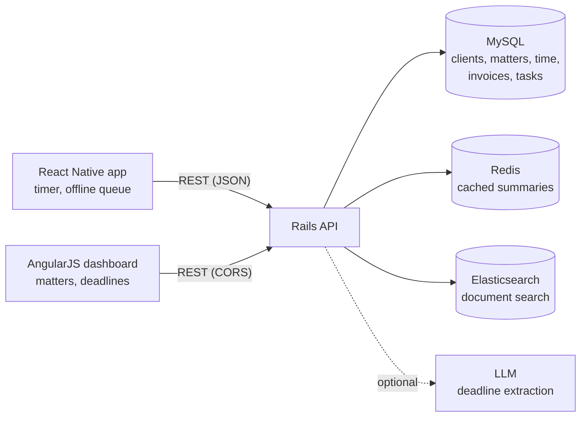

# LawDesk

[](https://github.com/Snehachowdary56/lawdesk/actions/workflows/ci.yml)

**Dashboard demo:** https://snehachowdary56.github.io/lawdesk/ (AngularJS, made-up sample data)

A small legal practice management product: a **Ruby on Rails** API, an **AngularJS** web dashboard and a
**React Native** time-tracking app for lawyers. It covers what law firms do every day: open matters (cases), check for conflicts of interest,
track billable time, send invoices, search case documents, and catch deadlines.



## What it does

| Part | Highlights |
|---|---|
| [`api/`](api/README.md): Ruby on Rails 7.2 | MySQL models with constraints; invoicing in one locked transaction (no double billing); Redis-cached matter summaries that refresh themselves; Elasticsearch search with stemming, typo tolerance and highlights; conflict-of-interest check with Levenshtein edit distance; deadline extraction from documents (rules, or an LLM with guardrails) |
| [`web/`](web/): AngularJS 1.8 | Dashboard of open matters, each matter's billing summary and its deadlines sorted and colour-coded (overdue, due this week); a component, a service over `$http`, and filters for money and "due in N days"; unit tests with ngMock (`$httpBackend`, `$componentController`) |
| [`mobile/`](mobile/): React Native (Expo, TypeScript) | Pick a matter, run a timer, save time in 6-minute billing units; entries are stored on the phone first and synced later, so nothing is lost offline; retries are safe because the API recognises an entry it already has |

## Tests

GitHub Actions runs everything on every push:

- **API:** 44 Minitest model, service and API tests against real **MySQL 8, Redis 7 and Elasticsearch 8**
- **Web:** 7 AngularJS tests with ngMock in Jest
- **Mobile:** TypeScript type check and 11 Jest tests (billing rounding, offline queue, sync, screens with React Native Testing Library)

## Built test-first: weekly time report

`GET /matters/:id/time_report?from=2026-10-01&to=2026-10-14` returns, for each week (starting Monday), billable and
non-billable hours and billed and unbilled amounts, plus totals. Weeks with no time are listed with zeros, so a chart has no gaps;
a range that ends before it starts, is longer than a year, or has a bad date is a 400 with a clear message.

It was built with test-driven development in [pull request #1](https://github.com/Snehachowdary56/lawdesk/pull/1):

1. Wrote 6 service tests for `TimeReport` and pushed them first: CI failed (`TimeReport` did not exist).
2. Wrote `app/services/time_report.rb` until they passed.
3. Wrote 3 API tests for the endpoint and pushed them: CI failed (no route).
4. Added the route and `TimeReportsController` until they passed.

The PR's CI runs show red, green, red, green.

## Run it

API: see [api/README.md](api/README.md). Web dashboard (API running on port 3000):

```
cd web
npm install
npm start
```

Open http://localhost:8080. Mobile:

```
cd mobile
npm install
npm test
set EXPO_PUBLIC_API_URL=http://<your computer's IP>:3000
npx expo start
```

Then open the app in Expo Go on a phone.

## Bug write-ups

See [BUGS.md](BUGS.md) for what caused the bugs I hit and how each one was fixed.
