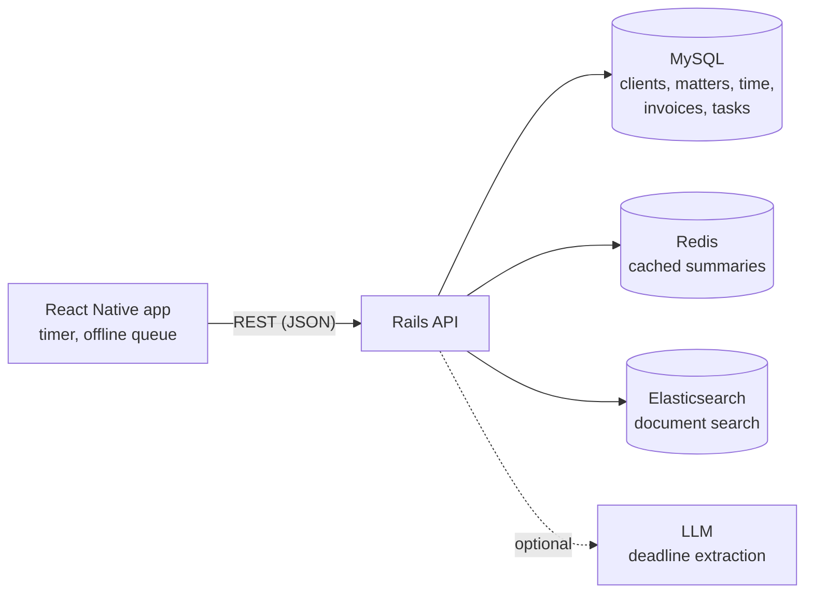

# LawDesk

[](https://github.com/Snehachowdary56/lawdesk/actions/workflows/ci.yml)

A small legal practice management product: a **Ruby on Rails** API and a **React Native** time-tracking app
for lawyers. It covers what law firms do every day: open matters (cases), check for conflicts of interest,
track billable time, send invoices, search case documents, and catch deadlines.



## What it does

| Part | Highlights |
|---|---|
| [`api/`](api/README.md): Ruby on Rails 7.2 | MySQL models with constraints; invoicing in one locked transaction (no double billing); Redis-cached matter summaries that refresh themselves; Elasticsearch search with stemming, typo tolerance and highlights; conflict-of-interest check with Levenshtein edit distance; deadline extraction from documents (rules, or an LLM with guardrails) |
| [`mobile/`](mobile/): React Native (Expo, TypeScript) | Pick a matter, run a timer, save time in 6-minute billing units; entries are stored on the phone first and synced later, so nothing is lost offline; retries are safe because the API recognises an entry it already has |

## Tests

GitHub Actions runs everything on every push:

- **API:** Minitest model, service and API tests against real **MySQL 8, Redis 7 and Elasticsearch 8**
- **Mobile:** TypeScript type check and 11 Jest tests (billing rounding, offline queue, sync, screens with React Native Testing Library)

## Run it

API: see [api/README.md](api/README.md). Mobile:

```
cd mobile
npm install
npm test
set EXPO_PUBLIC_API_URL=http://<your computer's IP>:3000
npx expo start
```

Then open the app in Expo Go on a phone.
